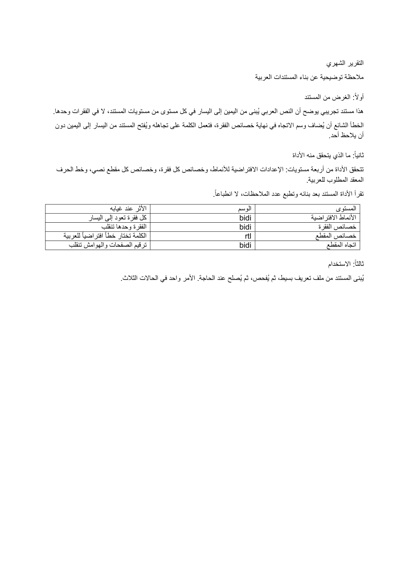

# arabic-first-docs

Build, check and repair Arabic-first Word documents.



The problem: python-docx makes it easy to write `w:bidi` into the wrong place inside `w:pPr`. Word ignores an element that sits out of schema order, so the document opens left-to-right and nobody notices until a reader does. Arabic then inherits a Latin font, tables mirror the wrong way, and page margins flip.

This tool sets direction at every level it has to be set, then **reads the file back and counts** which levels are missing. No impressions, no "looks fine to me".

```
$ python3 arabic_first_docs.py build examples/report.json report.docx
arabic-first-docs  ·  report.docx
PASS: docDefaults bidi, paragraph bidi, run rtl, complex-script font, section and table direction
```

## What "correct" means, in four places

| Level | Element | What breaks if it is missing |
|---|---|---|
| Style defaults | `w:docDefaults/w:pPrDefault/w:pPr/w:bidi` | Every paragraph reverts to left |
| Paragraph | `w:pPr/w:bidi`, before `w:spacing`, `w:ind`, `w:jc` | That paragraph alone flips |
| Run | `w:rPr/w:rtl` plus `w:rFonts/@w:cs` | Arabic picks a fallback font |
| Section | `w:sectPr/w:bidi` | Margins, page numbering and binding flip |
| Table | `w:tblPr/w:bidiVisual` | The first column renders on the left |

Order matters as much as presence. Every insertion goes through the schema sequence (`RPR_ORDER`, `PPR_ORDER`, `SECTPR_ORDER`, `TBLPR_ORDER` in the source), because a correct element in the wrong position is an element Word discards.

One more trap, found by rendering rather than by reasoning: in a bidi paragraph `w:jc="right"` means the **end** side, which is the left edge visually. So the tool leaves alignment unset and lets Word's `start` do the work. Setting `right` produces a perfectly directional document that still sits on the left of the page.

## Commands

```bash
python3 arabic_first_docs.py build SPEC.json OUT.docx [--lang ar|en]
python3 arabic_first_docs.py check OUT.docx [--json]
python3 arabic_first_docs.py fix IN.docx OUT.docx
```

- `build` writes a new document from a small JSON spec and immediately checks it.
- `check` audits any existing `.docx`, including one you did not write.
- `fix` repairs a document that already opens the wrong way, in place.

Exit codes: `0` pass, `1` the document fails a direction check, `2` usage or input error. Suitable for CI, a pre-delivery checklist, or a review gate.

## Spec format

```json
{
  "title": "التقرير الشهري",
  "subtitle": "ملاحظة توضيحية",
  "sections": [
    {
      "heading": "أولاً: الغرض",
      "paragraphs": ["فقرة أولى.", "فقرة ثانية."],
      "table": [["المستوى", "الوسم"], ["الأنماط", "bidi"]]
    }
  ]
}
```

Arabic only, English only, or mixed. In an Arabic document, Arabic paragraphs are set right-to-left and Latin fragments keep their own direction inside them.

## What it does not do

It does not typeset. No house style, no branding, no template inheritance, no proofing. It guarantees direction and reports on it, which is the part that silently fails and the part no spell-checker sees.

## Tests

```bash
pip install -r requirements.txt
python3 -m unittest -v
```

Thirteen tests: element presence at all four levels, schema ordering of `w:bidi` against `w:spacing`/`w:ind`/`w:jc`, detection of an undirected document, repair, English documents not being flagged, and CLI exit codes.

## Licence

MIT.
